# 申报书智能修改系统使用说明书

**产品名称：** 申报书智能修改系统（AI Application Form Editing System）  
**当前版本：** 2.7.2  
**访问地址：** http://127.0.0.1:3777（若 3777 被占用则自动改用 3778）  
**适用对象：** 申报组组员、组长、系统管理员、需要对接开放 API 的系统开发人员

本文面向**日常使用人员**编写，按真实界面逐步说明：从启动、登录、提交任务、核对计划、确认写入，到会话记录值班、AI 审核和管理后台。文中截图均取自本机实际运行界面。

---

## 目录

1. [系统能做什么](#1-系统能做什么)
2. [角色与权限](#2-角色与权限)
3. [安装、配置与启动](#3-安装配置与启动)
4. [登录、注册与退出](#4-登录注册与退出)
5. [主界面总览](#5-主界面总览)
6. [新建任务：上传申报书与修改意见](#6-新建任务上传申报书与修改意见)
7. [批量配对确认](#7-批量配对确认)
8. [任务状态与任务列表](#8-任务状态与任务列表)
9. [核对编辑计划并写入文件](#9-核对编辑计划并写入文件)
10. [成果下载、对照表与遗留事项](#10-成果下载对照表与遗留事项)
11. [缺附件检索与任务清单](#11-缺附件检索与任务清单)
12. [会话记录与 AI 值班](#12-会话记录与-ai-值班)
13. [AI 审核（意图评分）](#13-ai-审核意图评分)
14. [意见反馈](#14-意见反馈)
15. [开放 API 申请（普通用户）](#15-开放-api-申请普通用户)
16. [管理后台](#16-管理后台)
17. [开放 API 对接说明](#17-开放-api-对接说明)
18. [协同中心登录](#18-协同中心登录)
19. [安全原则与禁止事项](#19-安全原则与禁止事项)
20. [常见问题](#20-常见问题)
21. [附录](#21-附录)

---

## 1. 系统能做什么

本系统用于把**已填写的申报书**和**区域修改意见**交给 AI 生成可核对的编辑计划，经人工确认后再按**原版式写回源文件**。确认前不会改动原件。

核心能力一览：

| 能力 | 说明 |
|------|------|
| 模板自动识别 | 自动判断 **QM（启明，Word）** 或 **HJ（火炬，Word / Excel）** |
| 多格式申报书 | `.docx / .docm / .wps / .xlsx / .xlsm / .xls`；数字版 PDF 可转；扫描 PDF 走 OCR 后套模板，不直接当 Word 改 |
| 意见文档可选 | 可不传意见：系统读取申报书标注栏（Word / Excel 批注）。也可上传 Word、Excel、图片、录音、txt、md |
| Gemini 出计划 | 生产管线只用 Gemini 按章生成修改意见；人工逐条核对后再写入 |
| 版式保真 | Word 保持表格单元格结构；Excel 保留格式与宏（`.xls` 走本机 Excel） |
| 人才库 / 企业库 | 生成计划时只读检索，补齐空缺字段，**禁止编造库里没有的事实** |
| 缺附件检索 | 护照、学历证明、工作证明、论文全文、证件照、电子签、项目证明等：本机「附件」目录 → 人才库 → 企业微信聊天记录 → 论文系统 / 项目证明补缺 |
| 任务清单 | 护照扫描件、学历/工作证明及证明上的时间等**无法写入申报书正文**的事项，单独产出 `任务清单.docx` |
| 两阶段确认 | 计划生成后停在「待人工确认」；点「确认无误，写入文件」才会落盘 |
| 会话值班 | 关注企业微信群聊/单聊，自动识别申报书与修改意见，提交待确认任务 |
| AI 审核 | 用 Jev 对会话消息做意图评分，供组长审核甲方诉求 |
| 账号隔离 | 登录后才能使用；普通用户只看自己的任务；管理员看全部 |

典型工作流：

```
登录
  → 上传申报书（可多本）+ 修改意见（可选）
  → 多本时先做配对确认
  → 预处理（识别 QM/HJ、抽文本、查库、查附件）
  → Gemini 按章生成编辑计划
  → 人工逐条核对（采用 / 改写 / 放弃）
  → 确认写入
  → 下载：修改后文件、备份、对照表、遗留事项、任务清单
```

**系统改不了、也不会假装改掉的事情：** 护照扫描件本身、学历/学位证明扫描件、工作经历证明/在职证明扫描件，以及这些证明上的起止时间、入职/离职日期。这些一律进任务清单，由人工替换或补传。

---

## 2. 角色与权限

系统有三种角色，在管理后台「人员信息」中设置。

| 角色 | 界面名称 | 能做什么 |
|------|----------|----------|
| 普通用户 `user` | 普通用户 | 注册/登录、提交自己的任务、核对并写入自己的任务、看会话记录与值班待审、做 AI 审核分析、提交反馈、申请 API Key |
| 组长 `leader` | 组长 | 网页功能与普通用户基本相同，用于人员编制；告警推送里可按部门 @ 组长 |
| 管理员 `admin` | 管理员 | 以上全部 + 进入 `/admin` 管理控制台：人员、模型、值班配置、开放 API、告警、系统信息 |

权限要点：

- 未登录访问页面会跳到 `/login`，调用接口返回 401。
- 普通用户只能看到**自己提交的任务**；点别人的任务链接会得到 404。
- 历史无归属任务仅管理员可见。
- 模型配置的保存、恢复默认，仅管理员可做。普通用户在主页能看到 Gemini 参数，但保存会失败。
- 值班开关、扫描间隔类配置仅管理员；普通用户可以「立即扫描」（冷却 60 秒）。
- 会话 Cookie 有效期 7 天。

首次启动若库中还没有任何用户，系统会创建初始管理员：

- 用户名：`admin`
- 初始密码：`Admin@123456`

**请立即登录后台修改密码。** 该默认口令出现在公开文档中，不改会有越权风险。

---

## 3. 安装、配置与启动

### 3.1 运行环境

| 项 | 要求 |
|----|------|
| 操作系统 | Windows 10/11（Excel `.xls`、老式 `.wps` / `.doc` 依赖本机 Office） |
| Python | 3.10 及以上（推荐 conda 环境 `work`，或项目 `.venv`） |
| 数据库 | MySQL 5.7 / 8.x，库名默认 `shenbaoshu` |
| 浏览器 | Edge / Chrome 最新版 |
| 可选 | 企业微信聊天记录解析服务（源码在本仓库 `parser/`，默认 `http://127.0.0.1:8767`）；Tesseract OCR（扫描 PDF） |

### 3.2 安装依赖

在项目根目录执行：

```bat
pip install -r requirements.txt
```

主要依赖包括 FastAPI、uvicorn、python-docx、openpyxl、pymysql、httpx、Pillow、PyMuPDF 等。扫描 PDF 混合 OCR 为可选项，需另装 Tesseract（含 `chi_sim`、`eng` 语言包）。

### 3.3 配置文件

1. 将 `config.example.json` 复制为 `config.json`。
2. 把其中的占位符 `填入` 换成真实密钥。含 `填入` 的项视为**未配置**，对应能力会跳过并在遗留事项中注明。
3. `config.json` / `config.default.json` **不要提交到 Git**。

需要填写的主要配置块：

| 配置块 | 作用 |
|--------|------|
| `geminiApiKey` 与 `models` 中 Gemini | **生产管线唯一出计划模型**（默认 `gemini-3.7-flash`，思考中度，温度 0.1） |
| 顶层 `baseUrl` / `apiKey` / `model` | Grok 网关，仅管理后台可测，不参与出计划 |
| `doubaoApiKey` 与火山模型 | 同上，后台保留，管线不再调用 |
| `mysql` | 账号库：host / port / user / password / database |
| `pool` | 汪伦人才库 / 企业库只读接口（`X-API-KEY`） |
| `papers` | 论文/科研成果导出 API |
| `ps` | p 图工单 API：确认页填写备注和提交人后上传，未确认不上传 |
| `projectProof` | 项目证明：CodeBuddy 无头检索 + 生成 API 模板 |
| `wecomChat` | 企业微信会话看板与 AI 值班 |
| `alert` | 企业微信群机器人告警、催问关键词、交付日期播报 |
| `scanPdf` | 扫描 PDF OCR 策略 |
| `portal` | 协同中心单点登录 SDK |

规则提醒：

- 独立网关不要误用顶层 Grok 密钥。
- 火山地址已是 `/api/v3`，不要再拼 `/v1`。
- 用户前端 `/api/config` **不回传明文密钥**，也不展示 Grok / 火山 / 库地址。

根目录可放置 `QM.docx`、`HJ.docx` 作为模板比对样本；缺失时退回内置结构关键词判定，不影响使用。

### 3.4 启动

**方式一（推荐）：** 双击项目根目录 `start.cmd`。

它会：

1. 优先使用 `.venv\Scripts\python.exe`，否则使用本机 Python。
2. 只结束占用 3777 / 3778 的 **python / uvicorn**，不会杀 `svchost`。
3. 探测 3777；若被 Windows 端口转发占用，则改用 **3778**。
4. 启动后自动打开浏览器。
5. 进程退出后 3 秒自动重启。

若提示 3777 被 portproxy 占用，请**右键** `fix_portproxy.cmd` → **以管理员身份运行**，再重新 `start.cmd`。

**方式二：** 命令行

```bat
python run.py
```

默认监听 `0.0.0.0:3777`，本机用 http://127.0.0.1:3777 访问。环境变量 `SHENBAOSHU_PORT` 可改端口。

启动成功后，浏览器应看到登录页。

---

## 4. 登录、注册与退出

### 4.1 登录

打开系统后进入登录页。

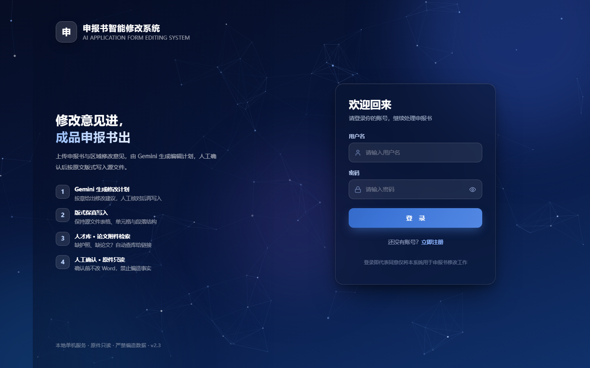

操作步骤：

1. 输入**用户名**和**密码**。
2. 可点密码框右侧眼睛图标显示/隐藏密码。若开启了大写锁定，会出现提示。
3. 点 **登录**。成功后：
   - 普通用户 / 组长进入主页 `/`
   - 管理员进入管理后台 `/admin`（也可再点「打开系统」回主页）

登录失败时，表单会抖动并显示原因（用户名或密码错误、账号已停用、数据库不可用等）。

还没有账号？点右下角 **立即注册**。

### 4.2 注册

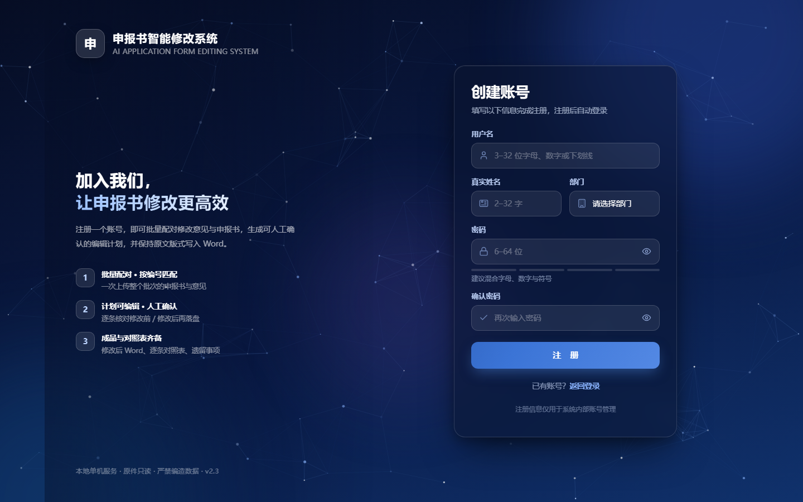

必填项：

| 字段 | 规则 |
|------|------|
| 用户名 | 3–32 位字母、数字或下划线；`admin` 在已有用户后不可自行注册 |
| 真实姓名 | 2–32 字 |
| 部门 | 从下拉选择（由管理员在后台维护，没有部门时无法注册） |
| 密码 | 6–64 位；下方有强度条，建议字母+数字+符号 |
| 确认密码 | 必须与密码一致 |

注册成功后**自动登录**并进入主页。

### 4.3 退出与用户菜单

登录后，右上角显示「真实姓名 · 部门」。点开下拉菜单：

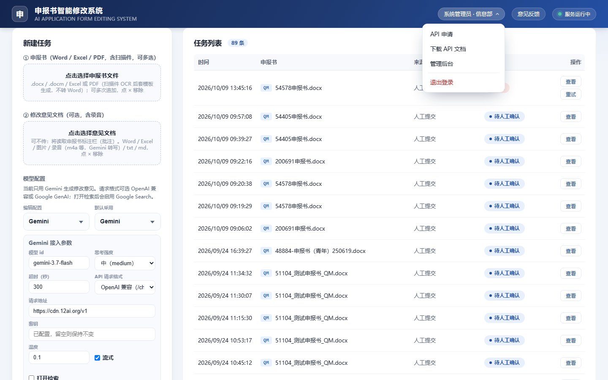

- **API 申请**：向管理员申请开放 API 密钥
- **下载 API 文档**：下载对接说明 Markdown
- **管理后台**：仅管理员可见
- **退出登录**：清除会话，回到登录页

右上角还有 **意见反馈** 按钮，以及「服务运行中」状态点。

### 4.4 协同中心进入（可选）

若单位把本系统挂在协同应用中心，可从侧栏打开 `/portal`。系统用协同中心的真实姓名和部门自动创建或登录账号。首次可能弹出「设置本系统账号」，需自行设定用户名和密码，以后也可在本系统登录页直接登录。

---

## 5. 主界面总览

登录后的主页分为上下几块。

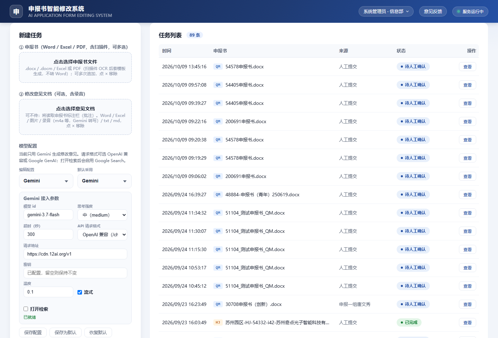

从上到下：

1. **顶栏**：系统名称、用户菜单、意见反馈、运行状态。
2. **左侧「新建任务」**：选申报书、选意见、看/改 Gemini 参数、提交。
3. **右侧「任务列表」**：本人历史任务，分页，点「查看」打开详情。
4. **配对确认区**（提交多本且需要核对时才出现）。
5. **任务详情 / 计划表**（点开某条任务后出现）。
6. **会话记录**：企业微信聊天看板 + AI 值班审核。
7. **AI 审核**：对关注会话做意图评分。

地址栏规则：打开某条任务后会变成 `/t/{任务id}`，刷新或把链接发给**同一账号**可回到该任务。浏览器标签页标题保持「申报书智能修改系统」，不随任务变化。

---

## 6. 新建任务：上传申报书与修改意见

这是最常用的入口。

### 6.1 选择申报书（必填）

在「① 申报书」点击虚线框，可**多选**。支持：

- Word：`.docx`、`.docm`、`.wps`
- Excel：`.xlsx`、`.xlsm`、`.xls`
- PDF：数字版、扫描件

说明：

- 可多次追加；每个文件右侧有 **×** 可移除。
- 扫描 PDF 会 OCR 后套模板生成，**不转成可编辑 Word 再当原稿**。
- 纯扫描且无法识别时任务会失败，可在列表中点「重试」。

系统会根据封面/结构自动打上 **QM** 或 **HJ** 标签（任务列表文件名左侧可见蓝色/橙色小标）。

**QM（启明）章节：** 基本信息、教育、工作、论文、项目、其他。  
**HJ（火炬）章节：** 关键申报信息、个人基本信息、教育、工作、学术荣誉、专长成果、工作设想、用人单位、其他。

### 6.2 选择修改意见（可选）

在「② 修改意见文档」点击虚线框，可多选。支持：

- Word / Excel / WPS / txt / md / csv
- 图片（jpg、png、webp、tif 等）
- 录音（m4a、mp3、wav、aac、ogg、flac、amr、wma、webm），由 Gemini 转写

**不传意见时：** 系统读取申报书里的批注（标注栏）。只要申报书里写了修改意见，仍然可以出计划。

建议意见文档里带上**申报书编号或人才姓名**，便于多本申报书批量配对。

### 6.3 模型配置（主页）

主页只展示 **Gemini**。普通用户可查看连通性；**保存 / 保存为默认 / 恢复默认仅管理员生效**。

常见项：

| 项 | 含义 |
|----|------|
| 模型 id | 默认 `gemini-3.7-flash` |
| 思考强度 | 短 / 中 / 长，生产建议「中」 |
| 超时（秒） | 单次请求上限，默认 300 |
| API 请求格式 | OpenAI 兼容 或 Google GenAI |
| 请求地址 | Gemini 网关，如 `https://cdn.12ai.org/v1` |
| 密钥 | 已配置时显示「已配置，留空则保持不变」 |
| 温度 | 出计划为 0.1，不宜随意调高 |
| 流式 | 可勾选 |
| 打开检索 | 勾选后启用 Google Search，一般出计划不必开 |

点 **检测连通性** 可确认当前密钥能否真正完成一次对话，结果不回传密钥。

### 6.4 提交

点 **提交任务**。

- **一本申报书：** 直接进入排队 → 预处理 → 出计划。
- **多本申报书：** 先进入「配对确认」页（见下一章）。
- 上传过程中按钮变为「上传中…」，请等待，不要重复点击。

单文件上限约 40MB（开放 API 同样限制）。

---

## 7. 批量配对确认

一次提交多本申报书（或一本申报书配多份意见）时，系统按编号 / 姓名把意见挂到对应的书上。

配对页会显示：

1. **每本申报书**命中了哪些意见块，可勾选或取消。
2. **共享意见**：一条意见命中多本时，勾选要写入的申报书。
3. **附加通用条款池**（默认开）：无归属的通用规范类意见，只附加给**已经配对到修改意见的书**。
4. **未配对**：有编号或姓名但找不到对应申报书，**不会执行**。

批量规则：

- 未配对到任何修改意见的申报书**直接跳过**：不套用通用条款、不创建任务。
- 匹配分数大致为：编号 90、前缀 85、全名 100；弱匹配会走 LLM 仲裁。
- 形如 `25xxxx` / `26xxxx` 的字符串视为日期码，**不参与编号匹配**。

核对无误后点 **开始执行**。每本通过配对的书会变成一条独立任务，出现在任务列表中。

---

## 8. 任务状态与任务列表

### 8.1 状态含义

| 列表显示 | 内部状态 | 含义 | 你该做什么 |
|----------|----------|------|------------|
| 排队中 | `queued` | 已受理，等待处理 | 等待 |
| 预处理 | `preparing` | 抽文本、识别模板、查库 | 等待 |
| Agent 执行中 | `running` | 正在按章生成计划或正在写入 | 等待，可看实时日志 |
| 待人工确认 | `planned` | 计划已生成 | **点查看，核对后写入** |
| 已完成 | `done` | 已写入源格式 | 下载修改后文件、对照表、任务清单 |
| 失败 | `failed` | 出错 | 看日志，点「重试」 |

来源列常见值：

- **人工提交**：主页上传
- **会话**：会话记录里拆解 / 勾选上传 / AI 值班自动提交

### 8.2 列表操作

- **查看**：打开详情与计划。
- **重试**：失败任务可从预处理重新跑，系统记录重试次数。
- 分页：底部「上一页 / 下一页」。
- 管理员在后台「任务总览」能看到全部用户的任务，每页 20 条。

打开任务后，详情区顶部有步骤条：

**排队 → 预处理 → 生成计划 → 人工确认 → 写入文件**

当前步骤高亮。待人工确认时，「人工确认」一步为橙色。

---

## 9. 核对编辑计划并写入文件

这是**质量把关的核心步骤**。计划生成后必须人工确认，系统不会自动改申报书（开放 API 里若显式传 `autoApply=true` 除外）。

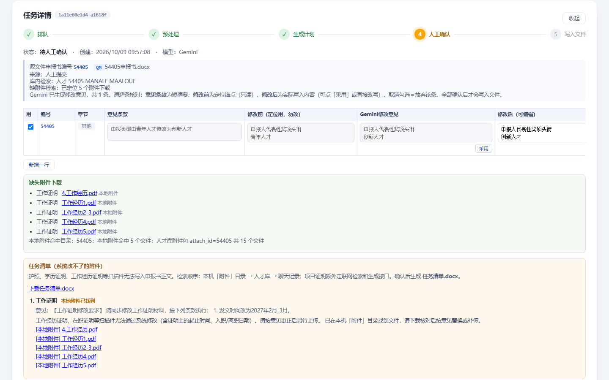

### 9.1 计划表表头

| 列 | 作用 |
|----|------|
| 用 | 勾选＝采用该条；取消＝放弃，不会写入 |
| 编号 | 申报书编号 |
| 章节 | QM/HJ 对应章节；人工补写行带「人工」标记 |
| 意见条款 | 短摘要，可改 |
| 修改前 | **定位锚点，只读**。必须能在原文中找到，系统靠它定位格子/段落 |
| Gemini修改意见 | 模型建议，只读 |
| 修改后 | **真正写入的内容**，可直接编辑 |
| ✕ | 删除该行 |

### 9.2 推荐核对顺序

1. 看顶部提示：申报书编号、QM/HJ、来源、库内检索、缺附件检索摘要。
2. 对每一行：
   - 先读「意见条款」，确认理解了专家/区域要改什么。
   - 再看「修改前」是否确实是原文中要改的那一块。
   - 点 **采用**，把 Gemini 意见填进「修改后」；或自己改写「修改后」。
   - 若这条不该改，**取消勾选**。
3. **黄底行「人工」**：库内没有对应数据，系统已定位原文并把「修改后」预填成原文，请人工填写正确内容。
4. **橙底行**：改前摘录在申报书中未找到，落盘可能失败。请先改锚点（新增行可编辑「修改前」）或取消勾选。
5. 需要额外改一处时，点 **新增一行**，自己填锚点和修改后。
6. 检查下方 **缺失附件下载**、**PS 修图工单**、**任务清单**、**遗留事项**。有护照/工作证明等改不了的扫描件时，先点「上传」，填备注和任务提交人后再确认写入。

### 9.3 写入

点 **确认无误，写入文件**。

- 按钮变为「写入中…」，请等待完成。
- 成功后状态变为「已完成」，可下载成果。
- 写入成功会把当时的 `output/` 拷到 `tasks/{id}/versions/{时间}/`，之后重试**不会覆盖**这一版快照。

**重新生成计划：** 点「重新生成计划」。会丢弃当前所有人工修改，从预处理重跑。请确认后再点。

### 9.4 写入时系统会强制遵守的版式规则

人工改「修改后」时也请遵守，否则可能超限或破坏表格：

- `find` 与 `replace` 的换行次数必须一致。
- 表格左栏标题与右栏正文不得并成一段。
- 印刷栏「限 N 字 / N 字以内」为最高优先级，目标约上限的 80%～90%，**不得超过上限**。
- 「引进企业基本情况」①业务领域～⑤产业链地位必须按格改，不能整栏塞进同一条。
- 除规定栏位外：不出现申报人姓名、企业名称；金额用万元、一位小数。
- 不得新增申报书没有的小标题；一次编辑只改锚点覆盖的那一块。
- 库和申报书都没有的事实写入遗留事项，**禁止编造**。

---

## 10. 成果下载、对照表与遗留事项

任务完成后，详情页「成果下载」通常包括：

| 文件 | 说明 |
|------|------|
| `原文件名_修改后.xxx` | 按原扩展名写回的成品（Word / Excel） |
| `原文件名_备份.xxx` | 写入前的备份 |
| `修改对照表.md` / `修改对照表.docx` | 逐条对照，含 Gemini 意见 |
| `遗留事项.md` | 模型或系统认为无法在正文完成的问题 |
| `任务清单.docx` | 护照/学历/工作证明等附件待办（有此类事项时才有） |
| `{编号}-人才库-vN.json` | 修改后的人才库字段（与 8091 格式相同），同时写入数据库并标明版本 |

详情页可预览对照表 Markdown，并下载 Word 版。

失败任务请先看「实时日志」，再决定重试或改文件后重新提交。

---

## 11. 缺附件检索与任务清单

当修改意见出现「缺护照」「缺少学历证明」「未上传学位证」「论文需附全文」「缺证件照」「电子签」「缺项目证明」等，或要求**更换扫描件、更正证明材料上的时间**时，系统会自动检索并在计划页展示。

### 11.1 检索顺序

1. **本机「附件」目录（优先）**  
   按申报书编号查找项目根目录：
   ```
   附件/{编号}/护照/
   附件/{编号}/工作经历/
   附件/{编号}/学历证明/
   …
   ```
   文件名含「学历证明」即使放在护照夹，也会按学历归类。命中后给出本系统下载链接。
2. **人才库附件包**（按人才编号 `attach_id`）。
3. **人才库 / 企业库 JSON** 中带下载地址的文件。
4. **企业微信聊天记录**中的群文件（须解析服务在线；按编号、姓名和「护照 / 学历证明 / 工作证明」等关键词）。下载走系统代理，浏览器拿不到上游密钥。
5. **论文系统**：库内无 PDF 时，按人才 ID 查档；无档或无 PDF 则按作者检索并构建，再拉取装订件与单篇 PDF，题录可写入申报书论文栏（引用数、影响因子未知则留空）。
6. **项目证明**：人才库没有时，用申报人姓名与**来华前工作单位**的项目列表，先 CodeBuddy 无头联网检索立项批文 / 资助公示；仍没有再调生成 API。签发单位必须是来华前工作单位，**不用申报企业**。无来华前雇主或与申报企业相同则跳过生成。

### 11.2 哪些进任务清单、哪些改正文

**进任务清单（系统改不了）：**

- 护照 / 身份证明 / 学历证明 / 工作证明 / 在职证明等扫描件的更换、补传、不清晰
- 工作证明、学历证明上的**起止时间、入职/离职日期、签发日期**

**仍走编辑计划（改正文）：**

- 护照号码
- 工作经历表格按职务职责 / 贡献改写
- 工作经历时间按年月填写

任务清单状态可能是：本地附件已找到 / 人才库已找到 / 聊天记录已找到 / 均未找到。Word 内含本地 `file:///` 链接和系统代理下载链接。

配置了 `ps`（p 图工单）后，人工确认页会显示「上传到 PS 工单」。点上传后填写**需要修改的备注**（可改）和**任务提交人姓名**，确认后才会把原件传到 p 图系统。未点确认不会上传。有此类任务清单时，须先完成上传才能点「确认无误，写入文件」。

计划页与完成后详情页都会再次展示缺失附件下载。

---

## 12. 会话记录与 AI 值班

主页下方「会话记录」连接本机企业微信聊天记录解析服务（默认端口 8767）。同一会话在多台电脑上合并为一条，**群聊和单聊都算**。

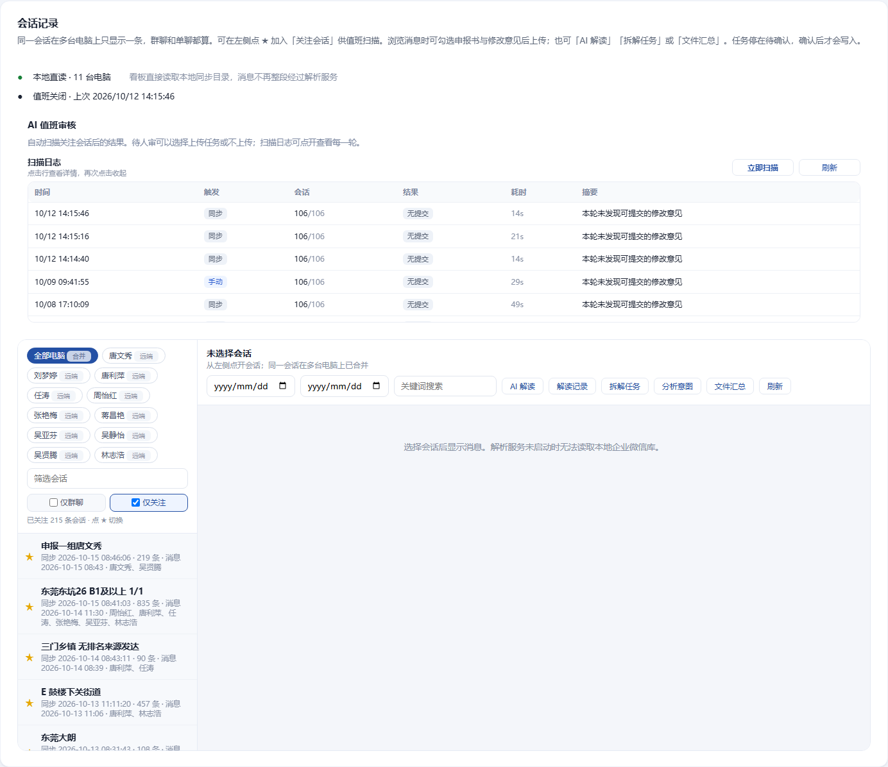

### 12.1 看聊天

- 左侧可按电脑筛选、搜索会话名。
- **仅群聊** / **仅关注**：默认勾选「仅关注」。
- 点会话左侧 **★** 加入关注，供值班扫描。
- 右侧可按日期、关键词筛选消息。
- 图片走企微 CDN 预览；文件卡从各电脑缓存下载（须在对应电脑的企业微信里打开过该文件）。
- `readMode=auto` 时优先直读已同步 JSON，不必整段走 HTTP，加载更快。

解析服务未启动时，无法读取本地企业微信库，界面会提示。

### 12.2 手工勾选上传

浏览消息时，可勾选申报书文件和修改意见（聊天文本或文件），再上传为待确认任务。**不会自动写入正文。**

申报书判定补充规则：

- 文件名带公司名（有限公司 / 股份有限等）的 Word、PDF、WPS，即使没有「申报书」三字，也视为申报书。
- 资料清单、聘用意向书、唯一申报承诺**不当申报书**。
- 正文里的短提示（「新申报书」「修改意见」）可给紧随的文件定角色。
- 缺缓存的申报书无法创建任务；意见文档未缓存时仍可建任务，并尝试从标注栏抽意见。

### 12.3 AI 解读

点 **AI 解读**：通读当前会话，扫描全部文件 → 按规则分类 → 按时间窗 / 编号 / 语义把申报书版本与修改意见绑定。

- 结果保存在右侧栏，可查看「解读记录」。
- **不自动创建任务**。
- 可切到「文件汇总」：按护照 / 学历 / 论文等类别归组，并定位各电脑副本中的原文。

### 12.4 拆解任务

点 **拆解任务**：按日期窗识别申报书，并把附近修改意见（群聊文本或意见文档，含 `.wps`）挂上。

- 未设日期时默认最近 14 天。
- 预览时会调用 Gemini 协助配对，硬过滤规则仍然生效。
- 预览确认后再上传，任务停在待确认。

### 12.5 定位申报书

文件卡上的 **定位申报书**：用姓名 / 文件名 / 编号 / 时间窗（当天、7 天、30 天）对已有任务打分，打开 `/t/{id}`，并可下载该任务的修改后文件、备份，以及会话里那份原文件。

### 12.6 AI 值班审核（主页）

展开「AI 值班审核」：

- **扫描日志**：每一轮扫描的时间、触发方式（同步 / 手动）、覆盖会话数、结果、耗时、摘要。点一行可看详情。
- **立即扫描**：普通用户可手动扫一轮关注会话，**冷却 60 秒**（刷新页面不会提前解开）。
- **待人审**（有条目时显示）：识别到的申报书和修改意见。可：
  - **上传任务**：强制建成待确认任务，之后仍要到任务列表点确认才写入。
  - **不上传**：移出列表。若管理员打开了「点过不上传的申报书不再进入待审」（默认开），之后扫描不会把同一份放回来。

值班模式由管理员在后台「会话记录」配置：

| 模式 | 行为 |
|------|------|
| 自动提交待确认任务 `auto` | 配对通过后直接建任务（仍不写入正文） |
| 只列入待人审 `review` | 只进待审列表，等人点上传 |
| 关闭 `off` | 不提交 |

首次扫描只记水位，避免把历史消息一次性全提交。聊天记录同步后做**增量扫描**，不按固定间隔空转。

管理员还可配置：回看窗口（小时）、判断超时、意见等待分钟数、任务归属账号、是否允许仅凭标注栏提交、是否把扫到的护照/学历等新文件自动上传到人才库。

---

## 13. AI 审核（意图评分）

主页最下方「AI 审核」用于判断会话里甲方在说什么，避免漏掉「请改申报书 / 请补材料」类消息。

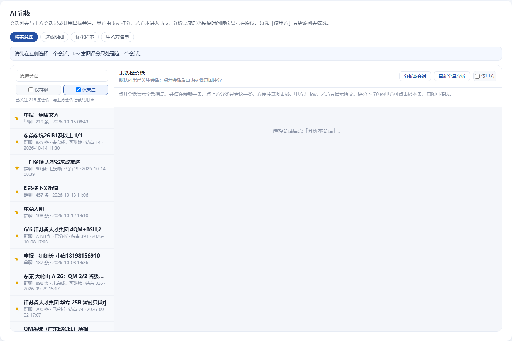

### 13.1 甲 / 乙方

- **甲方**：需要我方处理诉求的对方。企业微信里不在本公司名单中的人是甲方；个人微信里名字含 reaching 别名的永远是甲方。
- **乙方**：本公司人员。分析时**只展示原文、不进 Jev 评分**，分析完成后仍按原时间顺序显示在原位。
- 会话列表与上方「会话记录」**共用星标关注**。
- 勾选「仅甲方」只影响列表筛选，不改变评分范围。

在「甲乙方名单」页可：

- 维护 reaching 别名、本公司人员及别名、头衔正则（如申报组 / 匹配组 / 组员）。
- 「试一下判定」：输入发送人显示名，即时看甲 / 乙方。
- 高级用户可直接编辑 JSON 后覆盖名单。

### 13.2 分析会话

1. 左侧点开一个关注会话。
2. 点 **分析本会话**（已分析过可「继续分析」「增量分析」或「重新全量分析」）。
3. 可暂停。进度条显示百分比。
4. 评分 ≥ 70 的甲方消息出现在「待审意图」，可点 **审核本条**，意图可多选。

意图不写死成固定几类。明显的「收到」等短确认仍走规则；补材料、改字段、提问等业务句交给 Jev。题目里会带上更细的建议名（如「形式审核缺项」「核对薪资」）和组长纠正过的样本，避免把空白字段、催进度都收成「要求补材料」。审核时可改选分析结果，或手填更准确的名字。手填结果进入样本后，下次分析会出现在题目里。

「过滤明细」里是 Jev 判为闲聊/确认，以及评分不到 70 的意图，同样可以纠正。纠正结果进入「优化样本」，下次分析会把启用中的样本送给 Jev。

### 13.3 管理员样本库

管理员在后台「AI 审核」维护样本：置顶、停用、删除、按审核记录重建。下次分析最多把启用中的意图样本写入 Jev 题目（置顶优先）。

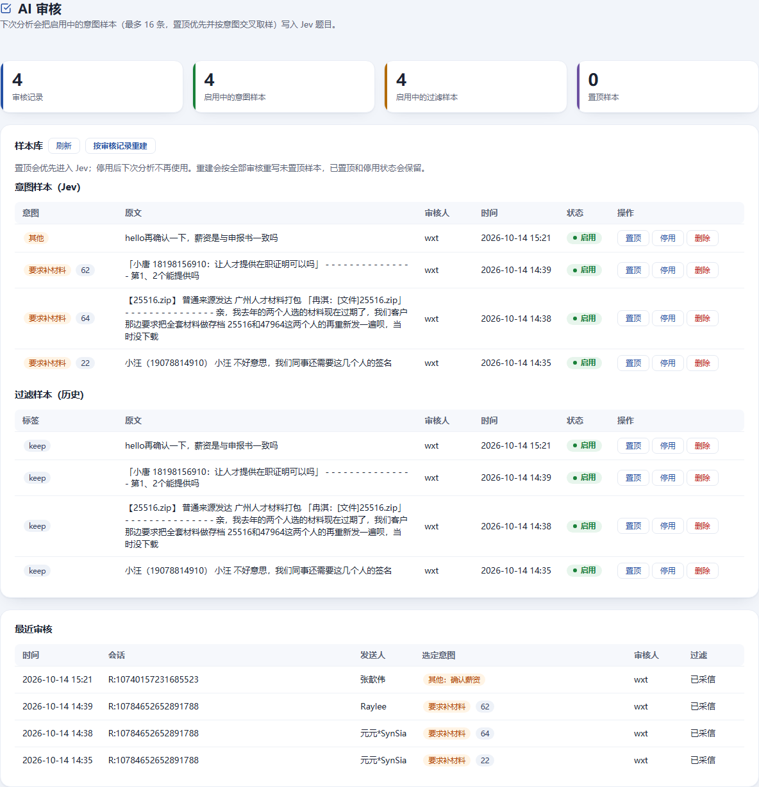

---

## 14. 意见反馈

点顶栏 **意见反馈**。

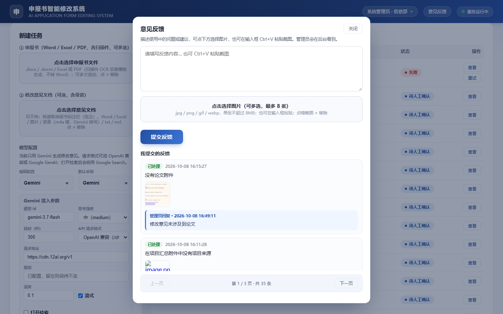

- 填写问题或建议（最多 4000 字）。
- 可选择最多 8 张图片（jpg / png / gif / webp，单张不超过 8MB），也可在输入框 **Ctrl+V 粘贴截图**。
- 提交后可在弹窗下方看到「我提交的反馈」及管理员回复。
- 管理员在后台把反馈标为待处理 / 已读 / 已处理。

---

## 15. 开放 API 申请（普通用户）

若要把本系统接到单位其它程序（自动上传申报书、查询进度），在用户菜单点 **API 申请**。

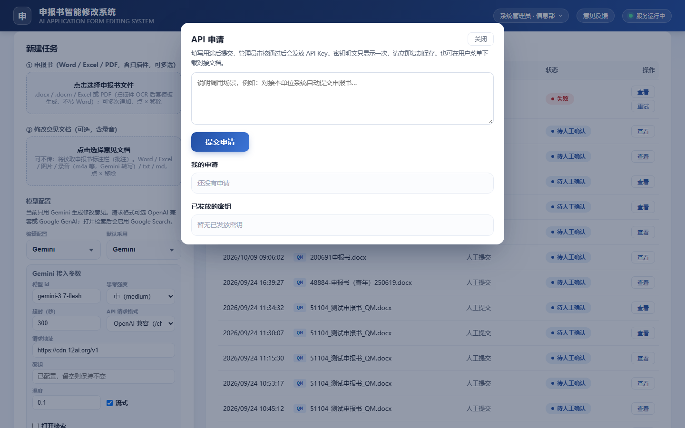

1. 填写用途（例如：对接本单位系统自动提交申报书）。
2. 提交后等待管理员审核。
3. 通过后，密钥明文会显示给申请人。**请立即复制保存**，不要写进公开仓库或前端页面。
4. 可在同一弹窗查看「我的申请」和「已发放的密钥」。
5. 用户菜单「下载 API 文档」可保存对接说明。

密钥与网页登录无关，请求头使用 `X-Api-Key`。详见第 17 章。

---

## 16. 管理后台

管理员登录后进入 `/admin`，右侧为锚点菜单。底部可设置自动刷新间隔（15s / 30s / 1m / 2m），**模型配置页不会自动刷新**，以免冲掉正在编辑的内容。

### 16.1 任务总览

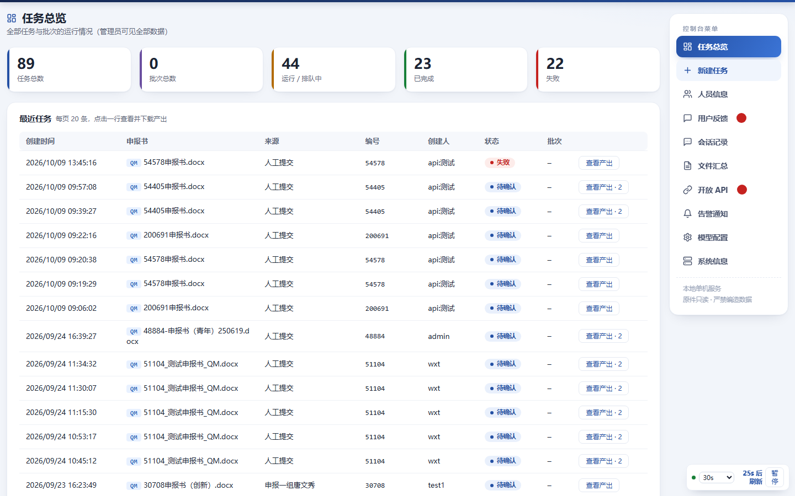

- 统计卡：任务总数、批次总数、运行/排队中、已完成、失败。
- 最近任务每页 20 条：创建时间、申报书、来源、编号、创建人、状态、批次。
- 点击申报书名称打开对应任务界面（新标签页 `/t/任务id`）。点击其余位置展开，可下载该任务产出。开放 API 创建的任务归属显示为绑定用户或 `api:密钥名称`。

### 16.2 新建任务

后台不重复做上传表单，而是引导到主系统。点「打开主系统新建任务」即可。

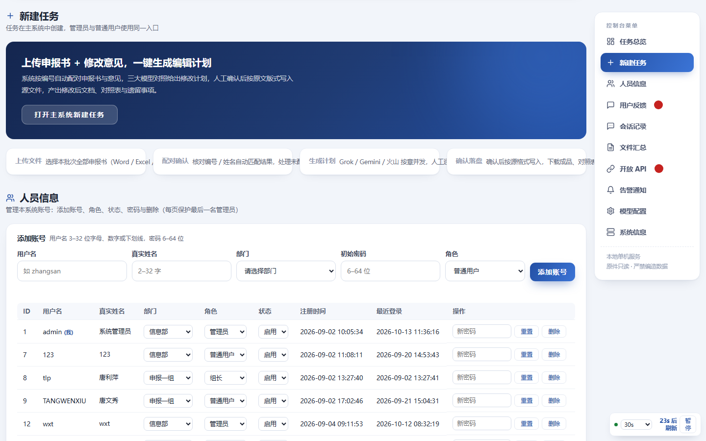

（页面上若仍写「三大模型对照」，以实际管线为准：**目前只用 Gemini 出计划**。）

### 16.3 人员信息

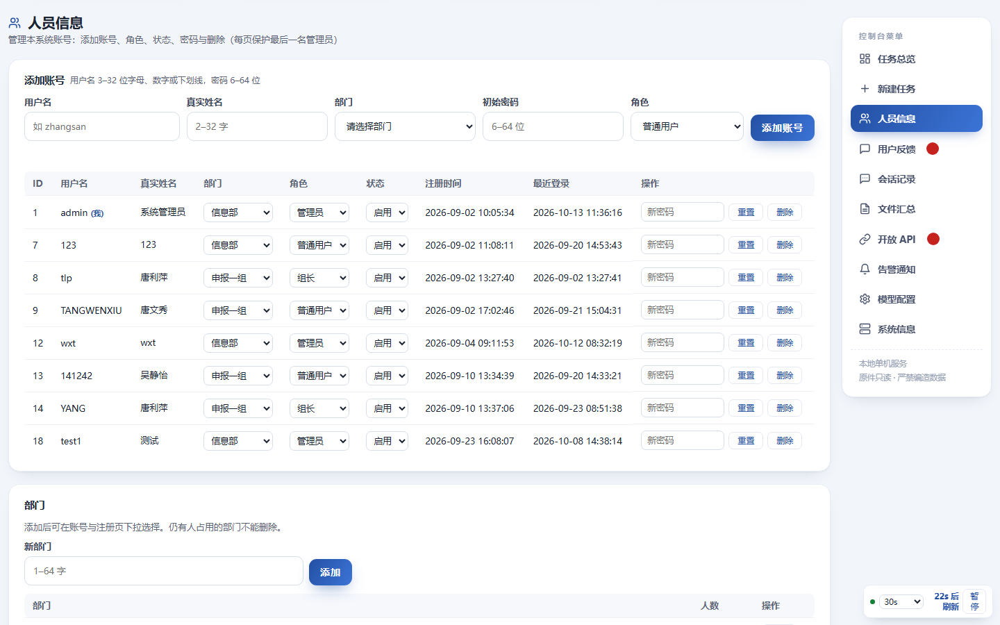

- **添加账号**：用户名、真实姓名、部门、初始密码、角色（普通用户 / 组长 / 管理员）。
- 表格中可改角色、状态（启用 / 停用）、部门；可重置密码、删除用户。
- **不能删除或降级最后一名管理员**。
- **部门**：添加后出现在注册页下拉；仍有人占用的部门不能删除。

### 16.4 用户反馈

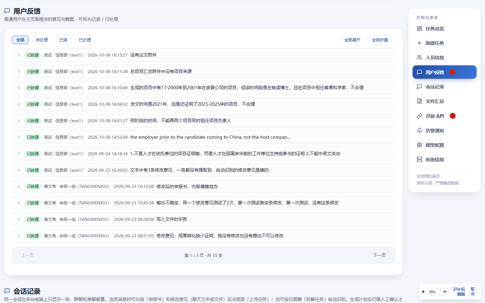

可按全部 / 待处理 / 已读 / 已处理筛选，展开查看正文和截图（支持放大预览），回复并将状态标为已读或已处理。

### 16.5 会话记录（后台）

与主页看板相同，并额外提供 **AI 值班扫描配置**（仅管理员）：

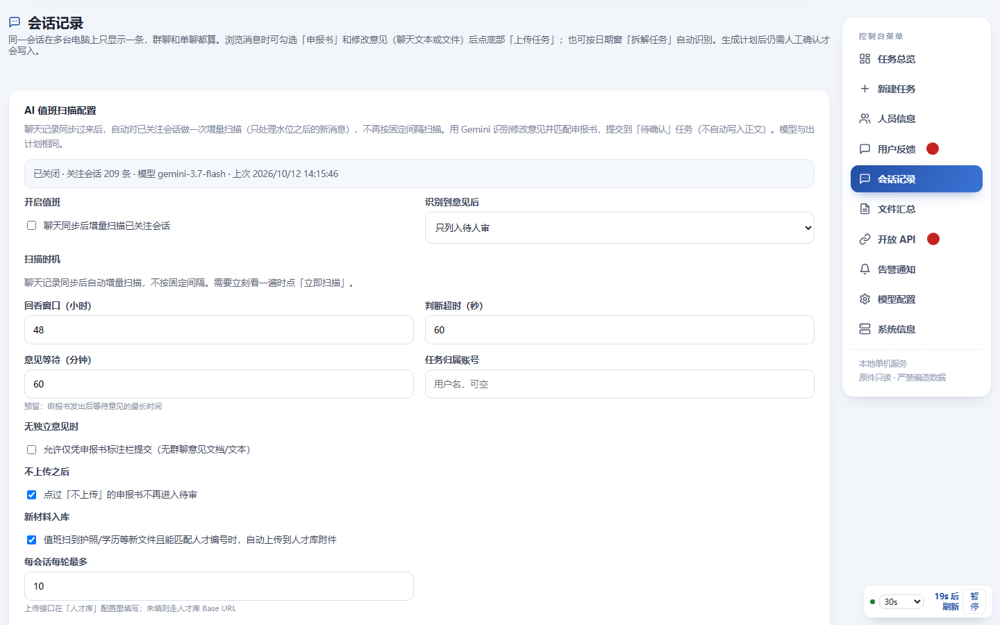

可配置开启值班、识别到意见后的动作、回看窗口、判断超时、意见等待、任务归属账号、无独立意见时是否允许提交、不上传后是否跳过等。可「保存值班配置」「检测 Gemini」「立即扫描」。新材料是否入库改到 **入库看板**。

侧栏若有「文件汇总」，对应会话右侧栏的材料归类，不是另一套任务系统。

### 16.6 入库看板（后台）

按人才编号查看已入库内容：

- **确认写入**：任务确认写入后的申报书字段 JSON（v1 / v2…），可下载、跳到对应任务。每版下面挂对应修改意见（来源申报书文件名、意见原文摘录、计划条款）
- **值班 / 文件汇总**：护照、学历等自动上传的材料

本页只配 **文件入库**：是否自动上传护照/学历等新材料、每会话每轮最多份数。会话扫描、待人审和扫描日志仍在「会话记录」。

### 16.7 AI 审核（后台）

见第 13.3 节。统计审核记录、启用中的意图/过滤样本、置顶样本；可刷新、重建、停用。

### 16.8 开放 API（后台）

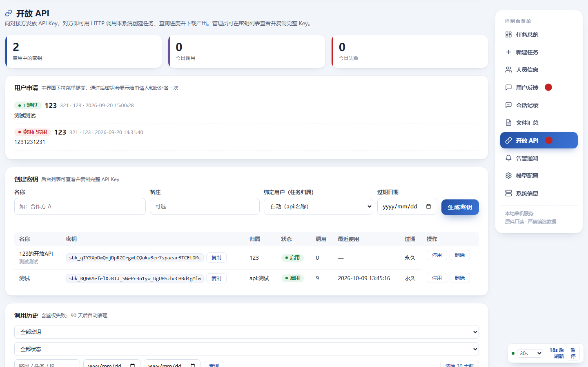

- 查看用户申请，通过或驳回。
- **创建密钥**：名称、备注、绑定用户（任务归属）、过期日期。生成后弹出完整 Key，列表中仍可复制。
- **编辑密钥**：改名称、备注、任务归属、过期日期。不会更换 API Key 本身。
- 可停用 / 删除密钥，立即失效。
- **调用历史**：按密钥、状态（2xx / 4xx / 5xx）、路径/任务/IP、日期筛选；含鉴权失败；约 90 天后自动清理；可清除 30 天前记录。
- 本页可预览 API 文档全文并下载 `.md`。

### 16.9 告警通知

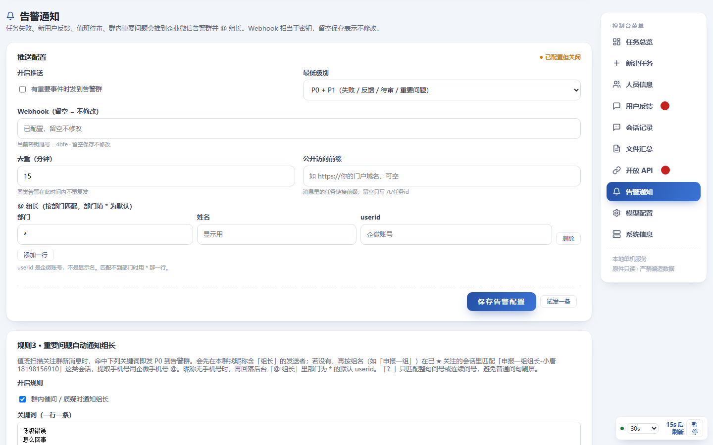

把任务失败、新反馈、值班待审、群内催问等推到企业微信告警群。

**推送配置：**

- 开启推送、最低级别（仅 P0 / P0+P1 / 全部）
- Webhook（群机器人地址，相当于密钥；留空保存表示不修改）
- 去重分钟数、公开访问前缀（消息里任务链接用）
- @ 组长：按部门匹配 userid（企微账号，不是显示名）；部门填 `*` 为默认

**规则3 · 重要问题自动通知组长：**  
值班扫描关注群新消息时，命中关键词（低级错误、怎么回事、尽快、急、涉嫌造假等）即发 P0。会先在本群找昵称含「组长」的发送者；若没有，再按组名在已关注会话里匹配「申报一组组长-小唐18198156910」这类会话，提取手机号 @。「？」只匹配整句问号，避免普通问句刷屏。

**交付日期定时播报：**  
按「创建时间 + SLA 工作日」估算预计交付，每天在设定时刻发到同一告警群。可设周末跳过、只播企微任务、空列表是否仍发送。可预览、立即播报、试发一条。

发送日志可按成功/失败筛选、刷新、清空。

### 16.10 模型配置

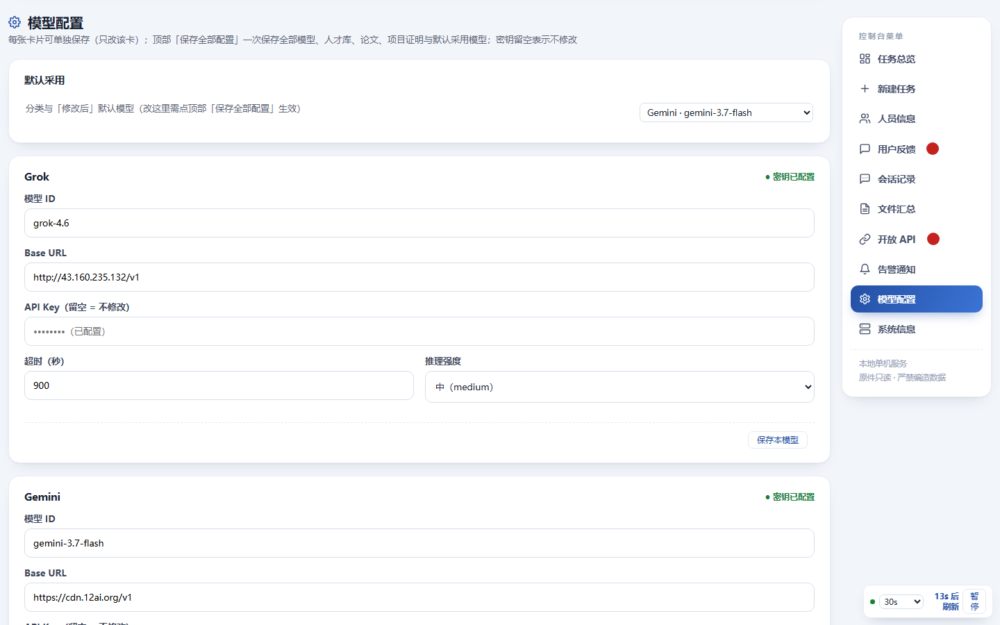

- 默认采用模型（分类与「修改后」默认，需点「保存全部配置」）
- 每张卡片：Grok / Gemini / 火山，可单独「保存本模型」
- 另有人才库、论文、项目证明、企业微信解析服务等卡片
- **密钥留空 = 不修改**
- 「保存全部配置」「恢复默认配置」「检测连通性」

生产出计划只用 Gemini；Grok / 火山用于后台测试与保留配置。

### 16.11 系统信息

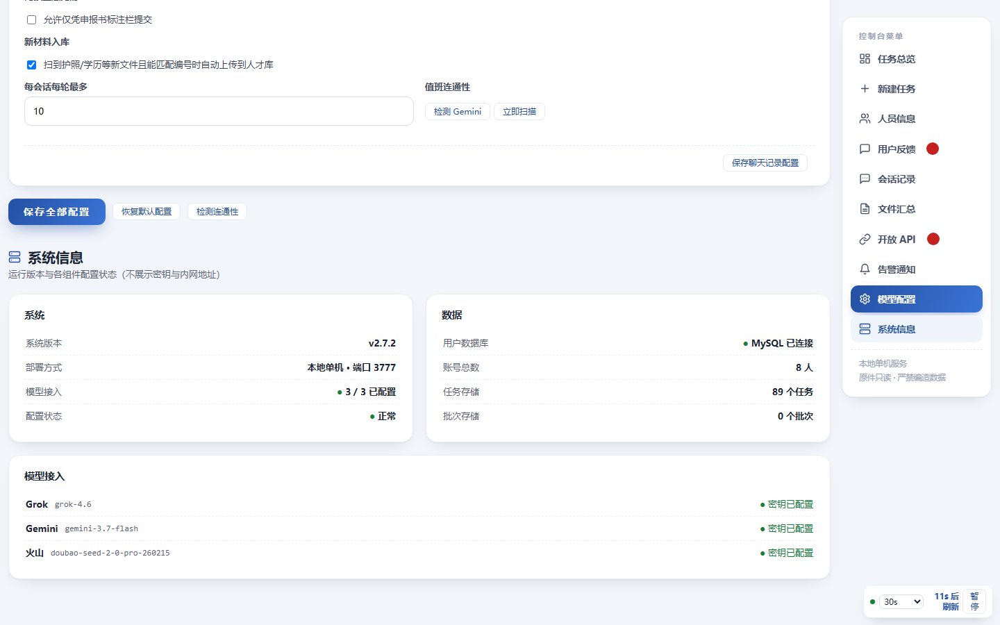

展示版本（当前 v2.7.2）、部署方式与端口、模型接入是否已配置、MySQL 是否已连接、账号数、任务数。**不展示密钥与内网地址。**

---

## 17. 开放 API 对接说明

完整约定亦见仓库根目录 `开放api文档.md`。后台「开放 API」页可预览同一份文档。

### 17.1 基本信息

| 项 | 值 |
|----|------|
| 前缀 | `/api/v1` |
| 本机示例 | `http://127.0.0.1:3777/api/v1/health` |
| 鉴权 | 请求头 `X-Api-Key: <密钥>`，或 `Authorization: Bearer <密钥>` |
| 网页 Cookie | **无效** |
| 单文件上限 | 40MB |
| 频率 | 每把密钥约 120 次 / 分钟 |
| 健康检查 | `GET /api/v1/health` 无需密钥 |

一把密钥只能看到自己创建的任务。

### 17.2 创建任务

`POST /api/v1/tasks`（推荐 multipart）：

| 字段 | 必填 | 说明 |
|------|------|------|
| `app` | 是 | 申报书文件 |
| `opinions` | 否 | 修改意见，可多文件；不传则抽标注栏 |
| `autoApply` | 否 | `true` 则计划生成后自动按 Gemini 意见写入 |
| `mode` | 否 | `QM` 或 `HJ`，不传则自动识别 |

```bash
curl -X POST "http://127.0.0.1:3777/api/v1/tasks" \
  -H "X-Api-Key: YOUR_KEY" \
  -F "app=@申报书.docx" \
  -F "opinions=@意见.docx" \
  -F "autoApply=true"
```

成功返回：`{ "ok": true, "id": "…", "status": "queued", "autoApply": true }`

也可用 JSON + Base64 上传。

### 17.3 查询、确认、下载

| 方法 | 路径 | 说明 |
|------|------|------|
| GET | `/api/v1/tasks` | 本密钥的任务列表 |
| GET | `/api/v1/tasks/{id}` | 状态、日志尾、产出清单 |
| GET | `/api/v1/tasks/{id}/plan` | 编辑计划（未就绪 404） |
| POST | `/api/v1/tasks/{id}/apply` | 确认写入；空 body 即采用 Gemini 意见 |
| POST | `/api/v1/tasks/{id}/retry` | 失败或待确认时重试出计划 |
| GET | `/api/v1/tasks/{id}/files?dir=output&name=` | 下载产出 |

建议每 2–5 秒轮询，直到 `planned` / `done` / `failed`。下载时 `name` 取任务 JSON 的 `deliverables[].name`。

### 17.4 错误码

| HTTP | 含义 |
|------|------|
| 401 | 缺少或无效的 API Key |
| 403 | 密钥已停用或过期 |
| 404 | 任务不存在或不属于这把密钥 |
| 400 | 参数 / 文件类型 / 当前状态不允许 |
| 429 | 超过频率限制 |
| 503 | 数据库不可用 |

---

## 18. 协同中心登录

路径 `/portal`。请从协同应用中心侧栏打开，不要当普通登录页收藏。

系统读取协同中心会话中的真实姓名、部门，调用 `/api/auth/portal-login` 自动开户或登录。若账号带有「必须设置凭据」标记，进入主页后会弹出用户名/密码设置框。

协同 SDK 地址与门户程序 id 写在 `config.json` 的 `portal` 块，由管理员配置。

---

## 19. 安全原则与禁止事项

1. **原件只读。** 确认写入前不改申报书；输出先写 `*_修改后` 和 `*_备份`。
2. **严禁编造。** 人才库、企业库、申报书原文都没有的事实，只能进遗留事项。
3. **密钥不出浏览器。** 附件下载由后端代拉；用户前端只暴露 `hasKey`。
4. **会话文件只走缓存。** 过期 CDN 链接不当下载源；须在对应电脑的企业微信里打开过该文件。
5. **值班不自动写入正文。** 最多建到「待确认」。
6. **数据隔离。** 不要把别人的 `/t/{id}` 当共享盘；对方无权限会 404。
7. **修改初始管理员密码。** 不要把 `config.json` 提交进仓库。
8. **API Key** 不要写进前端页面或公开文档。

---

## 20. 常见问题

**Q1：打开 http://127.0.0.1:3777 打不开？**  
看 `start.cmd` 窗口是否在跑。若改用了 3778，请访问 http://127.0.0.1:3778。3777 被 Windows 端口转发占用时，管理员运行 `fix_portproxy.cmd`。

**Q2：提示数据库不可用 / 无法登录？**  
检查 `config.json` 的 `mysql`：主机、端口、账号、密码、库名。MySQL 服务需要已启动。首次启动会自动建库建表。

**Q3：注册页部门是空的？**  
管理员需先在后台「人员信息 → 部门」添加部门。

**Q4：提交后一直排队或失败？**  
看任务实时日志。常见原因：Gemini 密钥无效或超时、扫描 PDF 无法识别、申报书不是 QM/HJ 结构、意见文档抽不出文本。失败可点「重试」。

**Q5：不传意见为什么有的书被跳过？**  
批量模式下，未配对到任何修改意见（文档或标注栏）的书会跳过，避免套用无关的通用条款。

**Q6：计划表「修改前」能不能随便改？**  
默认只读。它是定位锚点，改错会导致写不进对应单元格。只有「新增一行」时才能编辑锚点。橙底行表示原文没找到这段，不要强行确认。

**Q7：确认写入后发现改错了？**  
用备份文件或 `versions/{时间}/` 快照找回上一版；不要对已完成任务期望「撤销」。可基于备份再开新任务。

**Q8：会话里看不到文件、下不下来？**  
须在**该文件被打开过的那台电脑**上跑解析服务。换电脑没有缓存就下不到。解析服务 8767 未启动时看板为空。

**Q9：点了「不上传」，同一份申报书又出现在待审？**  
后台值班配置里打开「点过不上传的申报书不再进入待审」。关掉后允许重新进入。

**Q10：立即扫描提示冷却？**  
普通用户 60 秒内只能手动扫一次，服务端限制，刷新无效。管理员不受此限。

**Q11：Excel 宏会丢吗？**  
`.xlsm` 按单元格改写并保留 VBA。`.xls` 需要本机安装 Excel。请先在副本上试跑。

**Q12：扫描 PDF 能直接改原 PDF 吗？**  
不能。扫描件 OCR 后套模板生成，不把原 PDF 当 Word 回写。数字版 PDF 会先转 `.docx` 再走 Word 管线。

**Q13：论文栏一直空？**  
检查 `papers.apiKey` 是否已填。未配置时护照等仍可走人才库，但论文遗留事项会提示「论文 API 未配置」。

**Q14：项目证明为什么没生成？**  
必须能识别到来华前工作单位，且与申报企业不同。生成 API 配置含 `填入` 时会跳过。海外经历用英文、境内用中文。

**Q15：客户端年龄改写页 `/client-extract` 呢？**  
该独立页已下线，旧链接会重定向到首页。年龄相关改写请走正常申报书任务。

---

## 21. 附录

### 21.1 支持的申报书与意见格式

**申报书：** `.docx .docm .wps .xlsx .xlsm .xls .pdf`

**修改意见：** 上述办公格式 + `.txt .md .csv` + 图片 + 常见录音格式

**本机附件检索扩展名：** `.pdf .doc .docx .jpg .jpeg .png .tif .tiff .webp .zip .xls .xlsx`

### 21.2 本机附件目录示例

```
附件/
  54405/
    护照/
    工作经历/
      4.工作经历.pdf
    学历证明/
  4497/
    工作经历/
```

编号必须与申报书编号一致，系统才能优先命中本地文件。

### 21.3 QM / HJ 章节与规则文件

| 模板 | 章节 | 规则包 |
|------|------|--------|
| QM | 基本信息、教育、工作、论文、项目、其他 | `rules/basic-info.md`、`education.md`、`work.md`、`papers.md`、`projects.md` |
| HJ | 关键申报信息、个人基本信息、教育、工作、学术荣誉、专长成果、工作设想、用人单位、其他 | `rules/hj-key.md`、`hj-profile.md`、`hj-education.md`、`hj-work.md`、`hj-honors.md`、`hj-expertise.md`、`hj-plan.md`、`hj-employer.md` |

### 21.4 任务产出目录（供运维）

运行时数据在项目根（已 gitignore）：

- `tasks/{任务id}/`：输入、输出、计划、日志、版本快照
- `batches/`：批量配对
- `client_inbox/`：历史客户端材料目录（年龄改写页已下线）

不要把这些目录提交到仓库，内含申报书原文。

### 21.5 主页与后台功能对照

| 功能 | 普通用户主页 | 管理后台 |
|------|--------------|----------|
| 上传任务 / 核对计划 / 下载 | 有 | 总览里可代下产出 |
| 会话看板、拆解、AI 解读 | 有 | 有 |
| 立即扫描 | 有（60 秒冷却） | 有 |
| 值班开关与参数 | 只读状态 | 可配置 |
| 人员、部门、停用账号 | 无 | 有 |
| 发放 / 停用 API Key | 只能申请 | 有 |
| 模型密钥、人才库、论文、项目证明 | 仅看 Gemini | 完整编辑 |
| 告警 Webhook、交付播报 | 无 | 有 |
| AI 审核样本库 | 可审会话、写样本 | 可置顶/停用/重建 |

### 21.6 相关文档

| 文档 | 位置 |
|------|------|
| 开发与版本说明 | 项目根目录 `README.md` |
| 开放 API | `开放api文档.md` |
| 论文系统约定 | `论文api文档.md` |
| 配置示例 | `config.example.json` |

---

**文档版本：** 与系统 2.7.2 对应  
**编写说明：** 界面以实际部署为准；后台个别文案若仍提及「三模型对照」，生产管线已改为 Gemini 单模型。截图中的姓名、编号、会话名均为本机演示数据。
